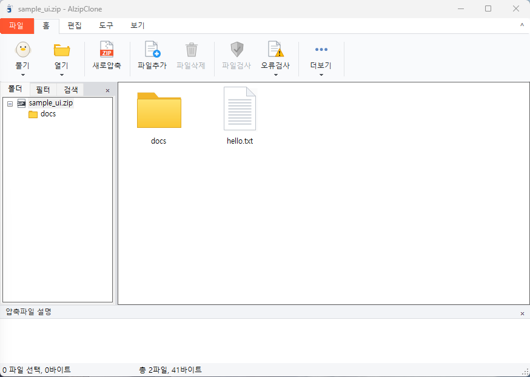

<div align="center">

# 🗜️ AlzipClone

**ALZip 12.37 Clean-Room Reimplementation in C# (.NET 8 WinForms)**

[](https://dotnet.microsoft.com/)
[-0078D6?logo=windows)](https://learn.microsoft.com/dotnet/desktop/winforms/)
[](#%EB%B9%8C%EB%93%9C-%EB%B0%8F-%ED%85%8C%EC%8A%A4%ED%8A%B8)
[](#%EC%95%88%EB%82%B4-%EB%B0%8F-%EB%A9%B4%EC%B1%85-%EA%B3%B5%EC%A7%80)

</div>

---

> [!IMPORTANT]
> **📌 대학 과제 제출용 리포지토리 안내**
> - 본 프로젝트는 **대학 강의(IT신기술) 과제 제출 및 평가 목적**으로 작성된 교육용 클린룸(Clean-Room) 재구현 프로젝트입니다.
> - 상업적 목적이나 배포 목적이 일체 없으며, 원본 소프트웨어(ESTsoft ALZip)의 바이너리·리소스·소스 코드를 복사하지 않고 관찰된 동작과 공개 포맷 명세만으로 직접 구현하였습니다.
> - **본 리포지토리는 과제 제출 및 성적 평가 완료 후 즉시 비공개 전환 또는 삭제될 예정입니다.**

---

## 🖼️ 실제 실행 화면

<div align="center">
  
</div>

---

## ✨ 프로젝트 소개

**AlzipClone**은 알집(ALZip 12.37)의 UI 레이아웃과 핵심 압축·해제 기능을 분석하여 **.NET 8 (C# WinForms)** 환경에서 클린룸 방식으로 재구현한 데스크톱 압축 유틸리티입니다.

- **정교한 리본 UI 재현**: `파일` 2단 백스테이지 팝업(최근 열어본 파일 포함), `홈` / `편집` / `도구` / `보기` 리본 탭, GDI+ 자체 제작 벡터 아이콘, 좌측 `폴더`·`필터`·`검색` 탐색 패널, 하단 `압축파일 설명` 영역 및 상태바 구현
- **다양한 압축 포맷 호환**: `ZIP`, `EGG`, `ALZ`, `TAR`, `TGZ`, `GZ`, `CAB`, `RAR`, `7Z` 포맷 지원
- **핵심 부가 기능 완비**: 암호화 압축(`ZIP 2.0` / `AES-128` / `AES-256`), 분할 압축 및 볼륨 병합(SHA-256 무결성 검증), 자동 풀림 실행 파일(`SFX .exe`) 생성, 포맷 변환, 압축파일 오류 검사, 문자 인코딩 전환(`UTF-8` / `CP949` / `EUC-KR` / `Shift-JIS` / `GB2312`)

---

## 📦 지원 압축 포맷

| 포맷 | 확장자 | 읽기 / 해제 | 생성 / 편집 | 구현 방식 |
| :--- | :--- | :---: | :---: | :--- |
| **ZIP** | `.zip` | ✅ | ✅ | `DotNetZip` 기반 (Deflate, Store, ZipCrypto, AES-128/256, 설명 편집) |
| **TAR / TGZ / GZ** | `.tar`, `.tgz`, `.tar.gz`, `.gz` | ✅ | ✅ | `SharpZipLib` 기반 스트림 아카이브 |
| **EGG** | `.egg` | ✅ | ➖ *(읽기 전용)* | ESTsoft 공개 스펙 v1.0 기반 **자작 바이너리 파서** (`EggArchive`, `EggCrypto`) |
| **ALZ** | `.alz` | ✅ | ➖ *(읽기 전용)* | ALZ 헤더/엔트리 구조 기반 **자작 바이너리 파서** (`AlzArchive`, `AlzCrypto`) |
| **CAB** | `.cab` | ✅ | ➖ *(읽기 전용)* | Windows `cabinet.dll` FDI 네이티브 P/Invoke **자작 바인딩** (`CabHandler`) |
| **RAR / 7Z** | `.rar`, `.7z` | ✅ | ➖ *(읽기 전용)* | `SharpCompress` 리더 위임 |
| **분할 볼륨** | `.vol1` + `.volmanifest` | ✅ | ✅ | 멀티 볼륨 분할 및 SHA-256 해시 검증 병합 (`SplitManager`) |
| **SFX** | `.exe` | ✅ | ✅ | 단일 실행 스텁(`SfxStub.exe`) + 후첨 ZIP 페이로드 빌더 (`SfxBuilder`) |

---

## 🖥️ 주요 화면 및 기능

| 구분 | 주요 기능 및 UI 구성 |
| :--- | :--- |
| **메인 창 (`MainForm`)** | • `파일` 백스테이지 메뉴 (새로압축, 압축열기, 포맷 변환, 닫기, 메일 첨부, 속성, 최근 파일 목록)<br>• `홈` / `편집` / `도구` / `보기` 4개 리본 탭 및 접기/펴기(`^`/`v`)<br>• 좌측 탐색 영역 (`폴더` 트리뷰, `필터` 조건 선택, `검색` 대소문자/재검색 필터)<br>• 우클릭 컨텍스트 메뉴, 상세/아이콘/간단히 보기 모드, 컬럼 정렬, 하단 설명창 |
| **새로압축 (`NewArchiveForm`)** | • 압축 대상 파일/폴더 추가·삭제 및 전체 크기 실시간 계산<br>• 포맷(`zip`/`tar`/`tgz`/`gz`), 분할 크기 프리셋, 압축률(5단계), 언어 인코딩, 암호 설정, 상세 옵션 접기/펴기(`-`/`+`) |
| **빠르게 압축풀기 (`ExtractForm`)** | • 드라이브·폴더 지연 로딩 트리뷰 및 경로 직접 지정, 새 폴더 생성<br>• 압축파일명 하위 폴더 자동 생성, 해제 후 원본 삭제, 해제 후 탐색기 폴더 열기 |
| **도구 모음 (`OpForms` / `Dialogs`)** | • **암호생성 (`PasswordCreateForm`)**: `ZIP 2.0 호환`, `AES 128bit`, `AES 256bit` 및 암호 감추기<br>• **압축분할 (`SplitForm`)** & **병합**: 프리셋/직접 입력 분할 및 볼륨 병합<br>• **알집 EXE 만들기 (`SfxForm`)**: 창 제목·기본 경로·안내 메시지 지정 자가 해제 `.exe` 생성<br>• **압축파일 속성 (`FilePropsForm`)** & **압축파일 설명 (`CommentForm`)**: 압축률·바이트 통계 및 코멘트 편집 |
| **환경설정 (`SettingsForm`)** | • 6개 카테고리(`보기설정`, `파일연결`, `탐색기 메뉴`, `압축하기`, `압축풀기`, `보안설정`) 및 설정 영구 저장(`%APPDATA%\AlzipClone\settings.json`) |

---

## 📂 프로젝트 구조

```text
AlzipClone/
├── AlzipClone.sln                  # 전체 솔루션 파일
├── AlzipClone.exe                  # 리본 UI 완성본 단일 실행 파일 (Release)
├── AlzipClone.Classic.exe          # 비교용 이전 UI 단일 실행 파일 (CLASSIC_UI 빌드)
├── SfxStub.exe                     # 자가 해제(SFX) 실행 스텁
├── src/
│   ├── AlzipClone.Core/            # UI 독립 핵심 압축 엔진 라이브러리
│   │   ├── Egg/                    # EGG 포맷 자작 파서 및 복호화 (EggArchive, EggCrypto)
│   │   ├── Alz/                    # ALZ 포맷 자작 파서 및 복호화 (AlzArchive, AlzCrypto)
│   │   ├── ArchiveService.cs       # 통합 포맷 디스패처 (Open, Extract, Create, Test)
│   │   ├── ZipHandler.cs           # ZIP 생성·해제·추가·삭제·이름변경·설명·암호 처리
│   │   ├── TarHandler.cs           # TAR / TGZ / GZ 처리
│   │   ├── CabHandler.cs           # cabinet.dll FDI P/Invoke 바인딩
│   │   ├── ForeignHandler.cs       # RAR / 7Z 읽기 처리
│   │   ├── SplitManager.cs         # 파일 분할 및 SHA-256 검증 병합
│   │   ├── SfxBuilder.cs           # SFX 실행 파일 생성기
│   │   └── AppDataStore.cs         # 환경설정(settings.json), 최근 파일(mru.json), 이력 관리
│   ├── AlzipClone/                 # 메인 WinForms 리본 UI 애플리케이션
│   │   ├── MainForm.cs             # 리본 탭, 파일 백스테이지, 탐색 패널, 리스트뷰
│   │   ├── RibbonIcons.cs          # GDI+ 벡터 리본 아이콘 렌더러
│   │   ├── FileIcons.cs            # SHGetFileInfo 및 고해상도 폴더/문서 아이콘
│   │   ├── NewArchiveForm.cs       # 새로압축 대화상자
│   │   ├── OpForms.cs              # 빠르게 압축풀기, 압축분할, 포맷 변환, EXE 만들기
│   │   ├── Dialogs.cs              # 암호생성, 암호입력, 설명 편집, 파일 속성, 제품정보
│   │   └── SettingsHistoryForms.cs # 환경설정(6개 탭), 이력 보기
│   ├── AlzipClone.Classic/         # 비교 시연용 클래식 메뉴/툴바 UI 프로젝트
│   └── SfxStub/                    # SFX 스텁 WinForms 프로젝트
└── tests/
    └── AlzipClone.Tests/           # xUnit 단위 및 상호운용성 테스트 (총 96개)
```

---

## 🚀 빌드 및 테스트

### 요구 사항
- Windows 10 / 11 (x64)
- [.NET 8.0 SDK](https://dotnet.microsoft.com/download/dotnet/8.0) (`net8.0-windows`)

### 바로 실행하기
루트 디렉터리에 빌드된 [`AlzipClone.exe`](./AlzipClone.exe)를 바로 실행할 수 있습니다.

```powershell
.\AlzipClone.exe
```

### 소스 빌드 및 단위 테스트 실행

```powershell
# 전체 솔루션 빌드
dotnet build AlzipClone.sln

# 전체 단위 테스트 실행 (96/96 통과)
dotnet test AlzipClone.sln

# 단일 실행 파일(Single-File) 배포 빌드
dotnet publish src\AlzipClone\AlzipClone.csproj -c Release -r win-x64 --self-contained false -p:PublishSingleFile=true
```

---

## 📜 라이선스 및 출처

- **자작 코드**: 과제 제출용 클린룸 구현 (ESTsoft와 무관)
- **EGG 포맷**: ESTsoft 공개 EGG 포맷 스펙 v1.0 기반 읽기 전용 파서 직접 구현 (스펙 라이선스 제3조의 EGG 압축 생성 금지 조항 준수)
- **오픈소스 라이브러리**:
  - `DotNetZip` (MS-PL)
  - `SharpZipLib` (MIT)
  - `SharpCompress` (MIT)
